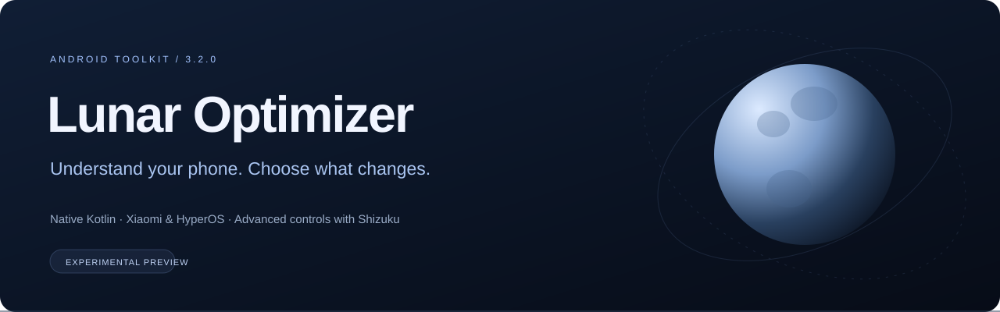

<p align="center"></p>

<p align="center"><strong>A native Android toolkit for Xiaomi 14 and HyperOS.</strong><br>Inspect your device, review system tweaks, and keep a record of what changed.</p>

<p align="center">


</p>

<p align="center"><a href="#downloads">Downloads</a> · <a href="#getting-started">Get started</a> · <a href="BUILDING.md">Build</a> · <a href="PRIVACY.md">Privacy</a> · <a href="STATUS.md">Status</a></p>

## What is Lunar?

Lunar Optimizer brings device diagnostics, package management, background app controls, and system tweaks into one Kotlin app. It started around a practical goal: make a Xiaomi 14 running HyperOS easier to understand and tune while keeping normal system animations.

Advanced operations use **Shizuku** and Android shell permissions. A root account or unlocked bootloader is not required. Availability depends on the phone, firmware, and permissions Android actually allows.

**3.2.0 is an experimental development snapshot.** The supplied APK is unsigned and must be signed before installation. Rollback machinery and unit tests do not establish compatibility or performance improvements on a real phone.

## What you can do

| Feature | What the current source implements |
| --- | --- |
| **Device dashboard** | Battery, RAM, storage, refresh rate, thermals, and hardware readings where Android exposes them. |
| **Optimize Now** | An evidence-based plan with conditional steps, a preview, and per-step results. |
| **Lunar Pack** | Curated settings and background restrictions, a per-item report, and removal controls. Experimental refresh-rate and long-press tweaks are separate from the default pack. |
| **Automatic mode** | Tiered app recommendations, protected packages, a keep list, review, and undo controls. |
| **Debloat** | Review packages, disable or remove them for the primary Android user, and restore eligible preinstalled packages. |
| **Deep Clean** | Inspect memory pressure, background offenders, caches, and candidate junk files before acting. Deleted files and caches cannot be restored by the settings journal. |
| **Benchmark mode** | Readiness checks, temporary background restrictions, supported Game Mode requests, and a local score log. Comparisons require three runs per mode; differences under 3% are labelled as noise. |
| **Launch timing** | A Pack cold-start check using the median of three `am start -W` launches and a saved baseline. |
| **Audio report** | Read-only exposed audio threads and Bluetooth codec information, plus a checklist. |
| **Change journal** | Serialized changes, original-value records, apply/restore verification, overlapping owners, and recovery states. |

Battery life, animation smoothness, launch speed, and benchmark gains need repeatable device measurements. Some optimizer frame/jank fields remain placeholders; see [current limitations](STATUS.md).

## Downloads

| File | Purpose |
| --- | --- |
| [LunarOptimizer-3.2.0-unsigned-aligned.apk](LunarOptimizer-3.2.0-unsigned-aligned.apk) | Original supplied APK, byte-for-byte. **Unsigned; signing is required.** |
| [LunarOptimizer-source-3_2_0.zip](LunarOptimizer-source-3_2_0.zip) | Original supplied source archive, unchanged. Includes historical development notes. |
| [SHA256SUMS](SHA256SUMS) | Checksums of both supplied files. |

The source ZIP contains the Android project. This repository adds refreshed documentation and a project website. The supplied application source and APK have not been rebuilt or changed for this launch.

## Getting started

1. Use Android 11 or newer. Xiaomi 14 / HyperOS 3 is the primary target; other devices are unverified.
2. Obtain an APK signed with a key you trust. For the supplied unsigned build, follow [the signing guide](BUILDING.md#sign-the-supplied-apk).
3. Install and start [Shizuku](https://shizuku.rikka.app/) using its official instructions, then grant Lunar access when prompted.
4. Begin with device information and preview screens. Review the reason and effect of each proposed change.
5. Apply a small set, inspect the results, and use matching restore controls when needed.

**Already using Lunar?** An update must have the same application ID and signing certificate as your installed version. If Android rejects a differently signed APK, restore changes in the installed app before considering an uninstall. Uninstalling or clearing app data erases the private rollback journal.

Restrictions can delay notifications or stop features. Package removal, compilation, cache cleanup, and file deletion have different recovery limits; read [usage and recovery](USAGE.md).

## Build and validation

Extract the source ZIP and enter the LunarOptimizer folder before building. The main build uses Kotlin, Android build-tools 34.0.0, **D8**, and a DEX check. Gradle files are included without a wrapper; that build route is unverified.

```bash
bash tools/get-toolchain.sh
bash build.sh
```

Toolchain setup prompts for Android SDK licenses. See [BUILDING.md](BUILDING.md) for requirements, signing, and JVM tests.

For this publication, the supplied archives passed ZIP integrity checks and the included DEX verifier reported **PASS: no invoke-custom call sites** for the APK. Source contains **61 `@Test` annotations**. Tests were not rerun, and the APK was not installed or tested on a device here.

## Privacy

The inspected source includes no account system, advertising/analytics SDK, or automatic diagnostic upload. Logs and benchmark entries stay in app storage unless manually copied or shared.

Network access is used for DNS checks of `example.com` and Xiaomi tracker hostnames through the configured resolver. An optional DNS tweak changes the system Private DNS provider. See [the privacy note](PRIVACY.md).

## Roadmap

- [x] Journaled changes and failure-path test sources
- [x] Automatic review and keep list
- [x] Deep Clean inspection and selected cleanup
- [x] Pack report and launch timing
- [x] Audio report and benchmark comparisons
- [ ] Real-device regression testing across HyperOS builds
- [ ] Complete frame/jank and battery-drain measurement
- [ ] Reproducible D8 builds with pinned downloads
- [ ] Stable maintainer signing and a signed release
- [ ] Application license choice and artwork provenance

## Contributing and credits

Include device, exact Android/HyperOS build, app version, permissions, reproduction steps, and a redacted log in bug reports. See [CONTRIBUTING.md](CONTRIBUTING.md).

An application-wide license has **not yet been selected**. Public source visibility alone does not grant a general redistribution license. Components keep their own terms: Shizuku API, Inter, and Kotlin. See [THIRD_PARTY_NOTICES.md](THIRD_PARTY_NOTICES.md).

An independent project maintained by [sebatech00](https://github.com/sebatech00). Not affiliated with Xiaomi, Google, or the Shizuku developers.
